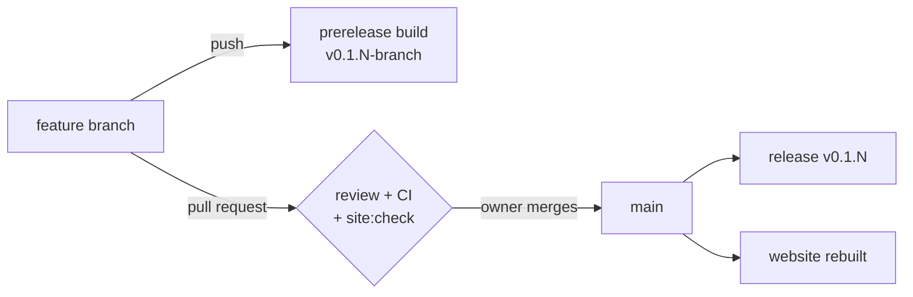

# Working methodology

Guidance for anyone — human or agent — continuing this project. Update it when
a rule turns out to be wrong or a new one earns its place; it is a living
document, not a charter.

## What this repository is

Two things, kept separate:

- **Analysis of the original 2003 Windows build** — `orig/`, `game/`,
  `symbols/`, `notes/`, `tools/`. Read-only archaeology.
- **A new game in Odin** — `src/`. The actual deliverable: a small core
  that is the original game, and everything Deimos Rose adds as plugins
  under `src/plugins/` (see "A small core" below).

`src/docs/` records progress per phase. `notes/odin-rewrite-plan.md` is the
overall plan. `src/docs/decisions.md` logs cross-cutting choices.
`src/site/` generates the public website from `site.config.json`
(`src/site/README.md`).

## A small core

The scope crept: by October 2026 one zip carried the game, netplay, two
new weapons, nine passives, a level editor, a terrain toolchain and a
second set of levels, and it had grown from 167 MB to 252 MB in four days.
Phase 10 (`src/docs/phase-10-plugin-split.md`) splits it, and the rule it
leaves behind is:

- **The core is the original game.** `sim/`, `data/`, `render/`, `ui/`,
  `prefs/` and `game/` hold what the 2003 build does, and the extension
  points plugins use. Nothing else.
- **Everything new is a plugin, installed separately.** A gameplay
  addition, a screen, a tool, a set of levels: a folder under
  `src/plugins/` that registers itself through the extension points, and
  ships as its own download. The game runs, and its tests pass, with no
  plugin installed.
- **Before building a feature, say where it installs.** If the answer is
  "in the core", the feature needs a reason in its pull request, and the
  reason is usually a missing extension point (see "Count the places a
  feature touches").
- **The core imports no plugin.** `src/game/plugins.odin`, the list of
  what is in the build, is the one core file that names one; `mise run
  purity` fails any other. A plugin reaches the core through the
  extension points below, never the core through a plugin.

## The core habit: verify, then build

Almost every significant finding in this project contradicted a reasonable
assumption. Check before building on it.

- 7-Zip "supports NSIS" — it cannot open this NSIS 2.0b1 installer at all.
- The CodeView blob "should" hold struct layouts — `sstGlobalTypes` is 8 bytes
  and empty.
- `vendor:ggpo` "is available in Odin" — it is Windows-only and will not link.
- The IA sprite plate "is an alpha mask" — it is, but *inverted*, and assuming
  otherwise produced 125 sprites on solid green.
- The original "launched and stayed running" under Wine — it was actually
  blocked on a "QuickTime could not be initialized" dialog. A process that does
  not exit is not a process that works.
- QuickTime "installs with winetricks" — its verb crashes and rolls back. The
  real cause, a missing Apple Application Support MSI, only showed up in a
  `+module,+seh` trace. When an installer fails, trace the failing load
  instead of retrying variations of the same install.
- A port that is "missing something" is usually doing *too much*. Both of the
  last divergences in Phase 4 were code the port added: invulnerability the
  original never granted, and an `unported()` marker on a function that in
  fact does nothing. Before adding a mechanism, check the original is not
  simply silent there.

**A false gap is worse than no gap.** `unported(site)` tells the diff that a
divergence beyond that point is expected, so a marker on code that does
nothing hides a real bug. Only mark a site after reading what it does.

The cost of checking is minutes. The cost of not checking is a phase built on
sand. When a claim matters, find the bytes that prove it and put the evidence
in the commit message or the phase doc.

**Compare state, not just behaviour.** The call diff says when a divergence
happened; the event diff says which entity; only a snapshot of the state
itself — shields, money, lives, position, step by step — says why. Values
drift silently for thousands of frames before they reach the RNG, so the
first *observable* difference is usually far from the cause. Extend the
oracle to record whatever you are guessing about; it is cheaper than guessing.

**Look at the output.** The sprite inversion was caught by opening the PNG, not
by reading code, and the QuickTime failure by taking a screenshot rather than
trusting an exit code. Decode a file, render an image, play a sound, print the
numbers. Counts passing is not the same as content being correct.

## Sources of truth, in order

1. **The original binary and its data.** `symbols/functions.csv` (1,942 names,
   99.9% boundary-validated), the PAKs, the shipped `DeimosRisingWin32.log`.
2. **Ghidra output** for behaviour that is not obvious from names.
3. **The clean-room remaster project** — genuinely useful format research in
   its `reverse/formats/`, and usable to us without restriction. But it was
   produced in 23 commits over two days and its "binary-confirmed" labels are
   self-asserted. **Where it and the binary disagree, the binary wins.**

Never let 3 override 1 silently. If you take a structural claim from the
remaster, say so and note whether you confirmed it.

## Rules that hold

**Build with CI's Odin.** CI pins Odin dev-2026-09; an older local Odin
can fail on vendor bindings (`terrain/model.odin` with dev-2026-07). Run
`MISE_ODIN_VERSION=dev-2026-09 mise run <task>` when the local default
is older, and do not take a toolchain failure for a regression.

**Every task lives in `src/mise.toml`.** If you ran a command to build,
extract, check or verify something, it belongs there as a task. Ad-hoc shell
invocations are how a project becomes unbuildable by anyone else.

**Add every new package to the `check` task.** A refactor once broke
`tools/extract` while `mise run check` stayed green, because the task did not
cover `tools/`. This is the one part of the scaffold that fails silently.

**`sim/` stays pure.** No `vendor:raylib`, no `core:os`, `core:fmt`,
`core:time`, `core:math/rand`, `core:thread` or `core:net`. It takes inputs and
a seed and produces state. `mise run purity` enforces it. Film replay, rollback
and fast tests all die without it, and it cannot be retrofitted cheaply.

**RNG lives in the state.** An ambient global generator desyncs rollback
silently. `G_Film::GetRandomSeed` shows the original made the same choice.

**Register through a named step.** An `@(init)` procedure only calls
`sim.register_step`. `sim.register_all` runs the steps in a fixed order,
and every `main` that touches the simulation calls it first. Odin orders
`@(init)` procedures differently for different targets, and a registry's
order gives the ids peers exchange. That once made a Linux host's Easy
Mode a Windows guest's Loadout (decisions.md D50).

**Classic mode is the original, exactly.** With classic mode on, the game
must look and behave as the 2003 build does: same sprites, colours, frames,
text and timing. Anything this port adds — a colour, an outline, a menu, a
smoothing — belongs to a *mod*, a plugin under `src/plugins/`
(decisions.md D40, D42). Its settings are registered with
`prefs.setting_register`, and it is read only through `prefs_mod_on`,
`setting_on` and `setting_value`, which classic mode switches off. Never
change a default look to suit an enhancement; put it in a mod.
Check a visual change with classic on as well as off. When the port
differs from the original in classic mode, that is a bug to port, not an
enhancement to keep (the crosshair's red lock was missing this way).

**Test cheaply.** Prefer a question the tools answer in one run over
rendering and eyeballing many frames: `mise run shots:find FIND='pbta frame
1'` lists the demo steps where a sprite/frame is drawn; `DR_DUMP` prints a
frame's draw list; `mise run menu-shot MENU=...` renders one screen. Look
at one image once the numbers say it is the right one. When a question
comes up twice, build the tool for it rather than a third ad-hoc script.

**Measure against the base with its own code.** `mise run ref
REF=<base> TASK=bench` runs the base's own task in a worktree of it
(`TASK=dps:report`, `TASK=build`). `mise run menu-shots:all OUT=dir`
renders every menu scenario (`ROOT=` the worktree's `src/` for the
base's), and `mise run menu-shots:diff A=base B=new` compares them.

**Tests must not require the original game data.** Use synthetic fixtures.
Integration checks against `game/` are fine but must skip cleanly when absent,
so CI runs for someone without a copy of the game. A test of the extracted
content starts from `assets_defs` (`src/tests/support`), which does the
skipping; `content_defs`, `weapon_index`, `play_start`, `unit_spawn` and
`mine_spawn` there, and the `Link` between two netplay sessions in
`src/tests/link.odin`, are the shared fixtures. Reach for them before
writing another. A plugin owns the tests of what it adds, in
`src/plugins/<name>/tests` (`mise run test` runs each).

**Never commit the original game itself.** `orig/`, `game/`, `src/build/`
and `src/.deps/` are ignored. The one exception is `src/assets/` — the
extracted, converted data the game loads — which the project owner chose to
commit so CI can ship playable release zips (decisions.md D29). Keep it
regenerable from a local installer copy with `mise run assets:all`.

## Branches and pull requests

Every change lands through a pull request from a feature branch. Nobody
commits or pushes to `main` directly; merging is the project owner's call.



- **One branch, one purpose.** Name it for what it does, in kebab-case
  (`runtime-plugins`, `fix-level-skip`); the name is also its site entry's
  `id` and its prerelease's tag suffix. Branch from the branch it builds on:
  `main`, or the integration branch while one is open (`ecs-refactor`
  until it merges). A branch that needs another unmerged branch stacks on
  it, and its pull request targets that branch, so each shows only its own
  diff.
- **Push feature branches; never `main`.** Every push to any branch builds
  both platforms and publishes a prerelease, so push when a branch is
  worth trying, not after every commit.
- **Every branch adds a site entry.** One entry at the top of `changes` in
  `src/site/site.config.json`, and the plugin list kept in step with
  `src/plugins/`. The pull request workflow runs `mise run site:check`
  and fails without it; `src/site/README.md` has the format.
- **Open the pull request with `gh pr create`**, against the branch it
  stacks on, with the body written as below.

### Writing the pull request

The pull request is read once, by someone deciding whether to merge. Make
it short, exact and good to look at. `.github/pull_request_template.md`
has the sections: **What**, **Why**, **How**, **Verified**, **Still open**.

- **Lead with the outcome.** The first paragraph says what is different,
  for a player or for the next developer. No preamble.
- **Draw the engineering.** An optimisation, a new extension point, a
  change to how data or control flows: show it as a `mermaid` diagram
  (GitHub renders them), before and after when something moved. A
  diagram replaces paragraphs; it does not decorate them.
- **Numbers, not adjectives.** Before and after, in a table: step time,
  zip size, snapshot bytes, DPS. Say how each was measured.
- **Verified is evidence.** List what ran and what it showed
  (`oracle:diff` exact, fingerprints unchanged, the screenshot you looked
  at), and say plainly what was not checked.
- **Keep it tidy.** Headings, short paragraphs, tables for comparisons,
  collapsed `<details>` for long logs. When later commits change the
  story, update the body rather than appending an "Update:" section.

## Commits and patch notes

Every push to `main` becomes a release tagged `v<major.minor>.<commits>`
(`src/VERSION` holds major.minor — bump it by hand for a milestone; the
last number is the commit count, from `src/tools/version/version.sh`). The
release notes are copied out of commit messages by
`src/tools/version/release_notes.sh`, so **the commit message is where
patch notes are written.** A push to any other branch builds too, and
becomes a prerelease tagged `v<major.minor>.<commits>-<branch>`, whose
notes list the branch's own `Changelog:` blocks and link the latest
release of `main`. Merge pull requests with a merge commit, not a
squash: the branch's commits, and their `Changelog:` blocks, then reach
the release.

Any commit a player would notice carries a `Changelog:` block after the
body and before the trailers:

```
Fix the level skip after finishing a level

<the usual body: what, why, evidence>

Changelog:
- Finishing a level no longer skips straight to the end of the game.
- Entering a high score no longer crashes.

Co-Authored-By: ...
```

- The line is exactly `Changelog:`. Each entry is one `- ` bullet; an
  entry that wraps continues on lines indented two spaces. The block ends at
  the first line that is neither, so a blank line or a trailer closes it.
- Write for players, not developers: what changed in the game, in plain
  words. No file names, function names or phase numbers.
- Commits with nothing player-facing (refactors, tests, docs, tooling)
  leave the block out. Do not write "Changelog: none".
- A release collects the blocks of every commit since the previous release,
  oldest first. `mise run release:notes` previews what the next one says.

## Balance

New content is tuned against numbers, not by feel. `mise run dps:report`
measures every weapon and passive level in the sim alone
(`WEAPON='Rear Gun'` for one weapon, in a second);
`src/docs/dps-report.md` says how.

- **Weapon passives have bands.** Measured by the report's Gain, level 1
  adds 10-20% to its weapon's DPS, level 2 20-40%, level 3 40-60%. When a
  level lands outside, say why in the code and in
  `src/docs/passive-upgrades.md` (the Rear Gun stops at +39.6%, for
  example).
- **Know the hit cap.** A target ignores a hit within one step of its last,
  so it takes at most 15 hits a second. Shots arriving together count once.
  Extra lanes help only against groups. Extra volleys and a shorter firing
  delay help a lone target, until the cap. A percentage off a firing delay
  counts only once it rounds to a whole step.
- **Avoid the damage stat (`Projectile_Damage`).** It changes a number the
  player cannot see: the shot looks the same and only the enemy dies
  sooner. Reach first for what shows on screen: more lanes, more volleys,
  faster fire, range, side fire. Use damage only when nothing visible can
  reach the band, and say so where it is used. Ground Variant 1 is the one
  case today: the Plasma Bomb's bursts already land at the hit cap, so
  every rate lever was spent. If damage is used, give it something to
  see. One option not built yet: boost the glow of the shot's particle
  effects with its damage increase.
- **Probe one lever at a time.** Set each level of a passive to a single
  modifier (explicit 0s, not `x`), run the report for that weapon, and
  read off what each lever is worth. Then combine. Guessing combinations
  wastes runs.

## Writing the code

The goal is a codebase that is a pleasure to read.

- Name things after what the original called them when the name is good
  (`G_Player`, `U_Pak`), and after what they do when it is not.
- Comments explain *why*, and record evidence: which address, which file, which
  observation. `data/tga.odin` and `tools/extract/main.odin` are the style —
  they say what was verified and against what.
- Mark provisional decisions as provisional, in the code, with what would
  resolve them.
- Prefer allocation-free designs where they are natural. Odin's test runner
  reports leaks; treat that as a failure, not noise.
- Keep faithful behaviour in `sim/` and write everything else the modern way.

## Continuous improvement

Leave the structure better than you found it: when a change is harder
than it should be, the difficulty is a finding, like a failed check. Fix
the cause, or record it, rather than only working around it.

**Count the places a feature touches.** Before building a feature in a
plugin, list every file outside the plugin (and its `view/`) that it would
change. More than its data means a missing extension point. The Discharge
Beam once needed seven: a field on the core's `Weapon`, parsing in the
loader, two branches in the weapon handler, a queue on `State`, and
drawing and clearing in the renderer and the game (decisions.md D48).
Then:

1. Add the generic extension point first, in its own commit, changing
   nothing observable: a registry, a hook, a registered key or event kind.
   Name it for what it does, never for the first feature to use it.
2. Move the existing feature onto it and prove the move neutral:
   `oracle:diff` exact, `tests/golden/fingerprints.txt` unchanged, and the
   feature's own numbers (`WEAPON=... mise run dps:report` for a weapon)
   and screenshots as before. Presentation particles take random
   directions, so compare two runs of the old build before calling a
   screenshot difference real.
3. Build the new feature on it.

**The core names no plugin's feature.** A field, branch, queue or draw
call in `sim/`, `data/`, `render/` or `game/` that exists for one plugin's
content is the same debt found later. `grep` for the feature's names
outside its plugin when you touch it. Move what you find behind an
extension point, or list it under "Still open" in the phase doc so it is
not forgotten.

**Questions are reviews.** When someone asks what it would take to add
something, and the honest answer is "edit N unrelated places", say so,
and propose the extension point that would make it one. Offering the fix
is part of the answer.

**The third copy is a helper.** When the same few lines appear a third
time, make them one procedure next to the data they work on, and replace
all the copies. First check whether a helper already exists
(`sim.Registry`, `walk_entities`, `cursor_walk`, `prefab_tag`,
`first_state`, `hit_taker`); a helper nobody finds is written twice.

**Use libraries through their public API.** odecs's internals and encoded
query terms are off limits outside `third_party/`, as `mise run purity`
enforces. When a rule like this matters, make a check enforce it, as the
purity and odecs checks do, rather than relying on everyone remembering.

**Record why.** A new extension point, or a rule that changes how
features are built, gets a decisions.md entry, and the table below stays
current.

The extension points today:

| To add | Use | Where |
|---|---|---|
| a step of the game | `system_register`, `player_stage_register`, `entity_stage_register` with `after`/`before` | `sim/systems.odin` |
| behaviour for units or states by their definitions | a component, `prefab_builder_register`, and a stage's `with`/`without` | `sim/prefabs.odin` |
| data on the session, players or entities | `kind_component` | `sim/ecs.odin` |
| a change to the core's numbers | `stat_provider_register` | `sim/hooks.odin` |
| a pause or a screen between levels | `hold_register`; `pause = true` for a pause the players asked for (`sim.paused`) | `sim/hooks.odin` |
| a plugin that is on exactly when the session is online | `online = true` in `plugin_register` (`sim.mods_online`) | `sim/plugins.odin` |
| which weapons are flown, and in what order | `weapon_chooser_register`, `weapon_filter_register` | `sim/hooks.odin` |
| a new way for a weapon to fire | `weapon_fire_register` | `sim/hooks.odin` |
| something that follows a shot's hit | `shot_hit_register` | `sim/hooks.odin` |
| a new key on weapon definitions | `weapon_key_register` | `sim/def_keys.odin` |
| an event for a plugin's view to draw | `effect_kind_register`, `effect_push` | `sim/queue_effects.odin` |
| something drawn in the frame | `render_system_register` | `render/render_systems.odin` |
| effects that live between steps and draw between layers | `effect_system_register` | `render/render_systems.odin` |
| a pass over the finished play field (lighting, glow, water) | `render.post_pass_register` | `render/post.odin` (D78) |
| a screen over the play field | `ui.overlay_register` | `ui/overlays.odin` |
| a setting on the Extras page | `prefs.setting_register`; `player = n` for player n's colour (`prefs.player_hue_setting`) | `prefs/settings.odin` |
| the Extras page itself | `prefs.settings_page_register` | `prefs/settings.odin` |
| a preview drawn on the Extras page | `ui.settings_preview_register` | `ui/settings_previews.odin` |
| a launch flag that turns a plugin on for one run (`-mod <name>` works for any) | `prefs.launch_switch_register` | `prefs/launch.odin` |
| a switch on Level Select or the netplay lobby | `ui.setup_switch_register` | `ui/setup_switches.odin` |
| presenting faster than the original's 30 frames a second | `render.frame_rate_register` | `render/frame_rate.odin` |
| records, weapons, sprites, im16 images and sounds of a plugin's own | `plugins/<name>/{data,sprites,images/im16,audio}` beside its code, a recipe in `tools/recolour/`, `content = true` | `data/assets.odin` (D49, D51) |
| a plugin with no code: content and a manifest | `plugins/<name>/plugin.json` beside its content, found at startup | `data/plugins.odin` (D52) |
| a campaign: levels played in their own order | `levels` in its `plugin.json`, records in `data/levels/`, maps and previews in `images/im16/` | `data/assets.odin`, `sim/defs.odin` (D53) |
| a screenshot scenario (`mise run menu-shot MENU=...`) | `ui.shot_register`; `ui.menu_shot_register` for a core menu with a plugin on | `ui/shots.odin` |

## Finishing a branch or a phase

A branch is finished when its pull request could be merged as it stands:

1. `mise run ci` green, and the change's own verification task green.
2. For a phase, write `src/docs/phase-N-*.md` while it is fresh: what was built, what the
   original turned out to do, what was decided and why, what is still open.
   Record the concrete numbers — they are the regression baseline.
3. Update the status table in `src/docs/README.md`.
4. Add any cross-cutting choice to `src/docs/decisions.md`.
5. Correct the plan if the phase proved it wrong. Phase 1 in the original plan
   claimed definition records would round-trip through JSON; that was
   misscoped and moved to Phase 3. Say so rather than quietly dropping it.
6. Add the branch's entry to `src/site/site.config.json` (`mise run
   site:check`), and look at it: `mise run site:serve`.
7. Push the branch and open its pull request (see "Branches and pull
   requests"). Stop there: the owner merges.

## Reporting

Say what was verified and how. Distinguish "the counts match" from "I decoded
it and looked at it". When something is unproven, say it is unproven. When an
earlier statement turns out to be wrong, correct it plainly once and move on —
several claims in `notes/` have already been corrected this way, and the notes
are better for it.
