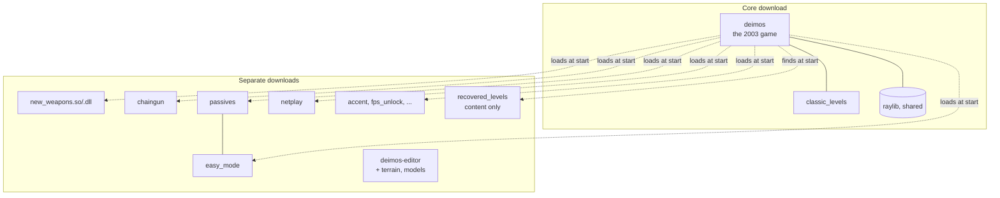
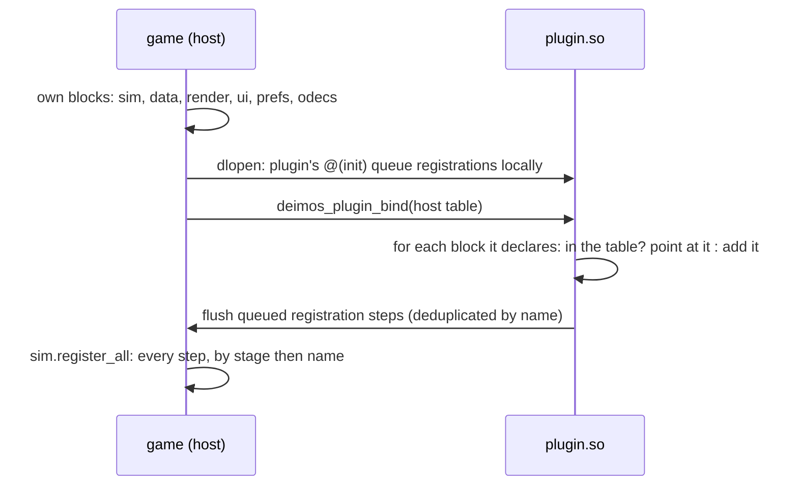

# Phase 10 — The plugin split

**Status: in progress.** Stage 0 (workflow and website) is on its branch;
the rest is planned below.

## Why

Every addition since Phase 5 rode in the one binary and the one zip. By
2026-10-06 the release carried the game, netplay, two new weapons, nine
passives, easy mode, a loadout screen, accent colours, a level editor, its
terrain toolchain and model library, and a second set of twelve levels.

| Release | Zip (Linux) |
|---|---|
| v0.1.239-ecs-refactor, 2026-10-02 | 167.8 MB |
| v0.1.276-ecs-refactor, 2026-10-06 | 252.8 MB |

What the zip holds today (sizes on disk, `du -sh`, 2026-10-08):

| Part | Size | Who needs it |
|---|---|---|
| `assets/` audio, data, sprites, images, films | ~85 MB | the game |
| `assets/models`, `materials`, `bases` | ~17 MB | the editor, to be confirmed in stage 5 |
| `plugins/classic_levels` | 55 MB | the game |
| `plugins/recovered_levels` | 34 MB | players who want them |
| `deimos-editor` | one binary | level makers |

And the code is not split either. The plugins are compiled into the game
(`game/plugins.odin` imports all sixteen packages), and `game/` names six
of them directly: `accent`, `easy_mode`, `fps_unlock`, `netplay`,
`new_weapons` and `extra_prefs` (29 call sites, counted 2026-10-08). So
the core cannot build without them, which breaks the rule in AGENTS.md
that the core names no plugin.

## Where it ends

- The core zip runs the original game, and nothing else, with no plugin
  present. Classic mode needs no plugin at all.
- A code plugin is a shared library (`plugins/<name>/<name>.so` or
  `.dll`) beside its content. The game loads every one it finds at
  startup, in dependency order, before `sim.register_all`.
- A content plugin (levels, campaigns) is a folder with a `plugin.json`,
  as data plugins already are (D52).
- The level editor is a download of its own.

## The hard part: one copy of the state

An Odin shared library that imports `dr:sim` compiles its own copy of
`sim`, globals included. A plugin's `@(init)` would register its systems
into its own copy, and the game would never see them.

The fix keeps every package's code as it is and moves its mutable
package-level state behind one pointer, which the loader points at the
game's state:

### Verified by a spike (2026-10-08, Odin dev-2026-07, Linux)

A host and a `-build-mode:shared` library sharing one package, in the
scratchpad, before any of this was planned:

- **Binding works.** After the plugin pointed its copy of `core.g` at the
  host's block, both sides read and wrote the same dynamic array and map:
  a map entry the host wrote was found by the plugin's lookup, and the
  reverse.
- **typeids agree.** `typeid_of(core.Thing)` was equal in host and
  plugin: they are hashes of the type, not table indexes. odecs keys
  components by typeid, so this was the deciding question.
- **Floating point agrees.** A 1,000-term float sum was bit-identical in
  both, as expected from the same compiler and flags.
- **`@(init)` runs at `dlopen`**, before the host can bind anything, so
  registrations must queue in the module and be flushed on bind.
- **Registrations after binding were lost** in the spike's first cut
  (they went to the plugin's local queue). Once bound, registration must
  write straight to the shared block.
- **Hazard:** `type_info_of` on a typeid only the plugin defines returned
  a non-nil but empty record in the host. The host must never format or
  reflect on a plugin's own types (`fmt` with `%v`, for one).

Not yet verified: the same on Windows (DLL `@(init)` from `DllMain`, the
process heap shared between modules), and raylib built shared
(`-define:RAYLIB_SHARED=true`, `libraylib.so.600` and `raylib.dll`, both
present in Odin's vendor tree) drawing from a plugin. Stage 3 starts with
both.

### What has to move

Package-level variables, counted 2026-10-08 (excluding tests): about 100
declarations across `sim` (29), `odecs` (12), `data` (10), `render` (4),
`prefs` (4), `ui` (2), `sim/systems/collision_system` (3), and the plugins
(about 50). Two kinds:

- **Literal tables** (`SIN_BITS`, `GLYPH`, `LEVEL_ORDER`, `DEPS`): the
  same in every module, so a copy is harmless. They become `@(rodata)`.
- **State** (registries, pools, plugin IDs set at registration such as
  `new_weapons.ID`, the view packages' effect lists): moves into the
  package's shared block.

A check (`mise run purity`, extended) then fails any package-level
variable that is neither `@(rodata)` nor in a block, so the rule cannot
erode.

## Stages

Each stage is a feature branch and a pull request, stacked on the one
before, each with its site entry.

| # | Branch | What | Done when |
|---|---|---|---|
| 0 | `site-and-workflow` | The website, its generator and Pages deployment; the pull request workflow and `site:check`; AGENTS.md for branches and pull requests; this plan | PR open, site builds, check passes |
| 1 | `core-names-no-plugin` | Extension points for what `game/` asks of plugins: frame pacing, ship accents, level-select toggles, lobby toggles, netplay pause. `game/` imports no plugin; `mise run purity` enforces it | `game/plugins.odin` is the only file that names a plugin; oracle and fingerprints unchanged |
| 2 | `shared-state` | `dr:shared`: blocks, bind and flush; every package's state moved into its block, tables to `@(rodata)`; the check | neutral: oracle, fingerprints, DPS report unchanged |
| 3 | `runtime-plugins` | Plugins built as shared libraries, raylib shared, the loader, an ABI stamp the loader checks, Windows verified in CI; `game/plugins.odin` gone | the core zip plays classic with `plugins/` empty, and with every plugin loaded plays as before |
| 4 | `netplay-plugin` | The lobby, session and `net/` out of `game/` into the netplay plugin, behind a session-driver extension point | the netplay loopback checks pass with the plugin, and the core has no netplay |
| 5 | `separate-downloads` | Release split: core zip, one zip per plugin, the editor zip, Recovered Levels zip; the site's download page lists them | each zip installs by unzipping into the game folder |

## Decisions to record as they are made

- Plugins are built from the same commit as the game they load into, and
  the loader refuses any other (an ABI stamp: a hash of the core's
  sources). Mixing releases is out of scope.
- Netplay peers already compare a registration hash (`registration_hash`,
  D50); a loaded plugin's stamp joins it, so peers with different plugin
  builds refuse each other instead of desyncing.
