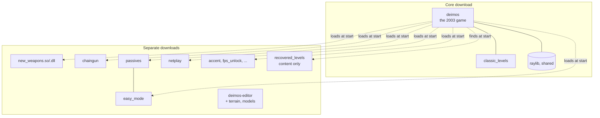
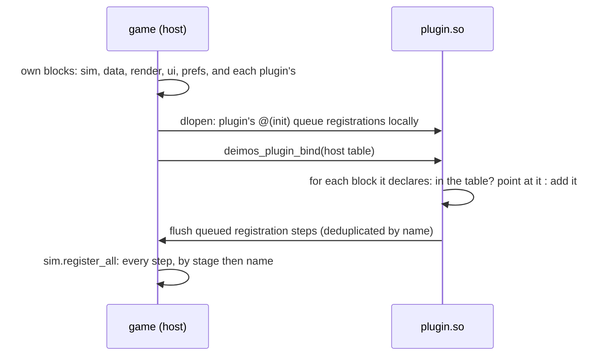
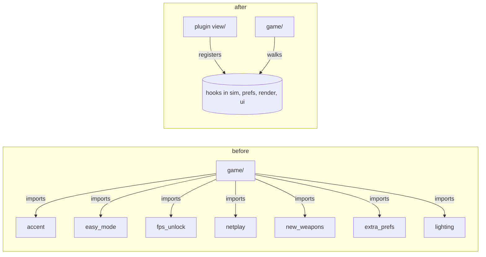
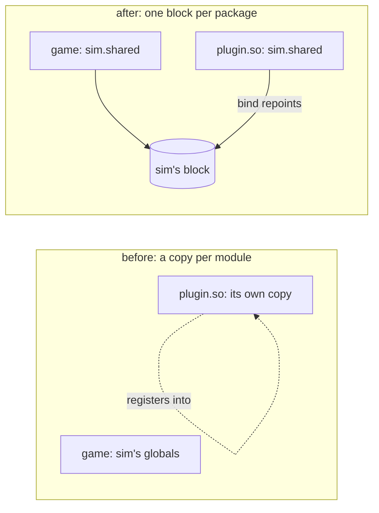

# Phase 10 — The plugin split

**Status: in progress.** Stage 0 (workflow and website) and stage 1 (the
core names no plugin) are on their branches; the rest is planned below.

## Why

Every addition since Phase 5 rode in the one binary and the one zip. By
2026-10-06 the release carried the game, netplay, two new weapons, nine
passives, easy mode, a loadout screen, accent colours, a level editor, its
terrain toolchain and model library, and a second set of twelve levels.

| Release | Zip (Linux) |
|---|---|
| v0.1.239-ecs-refactor, 2026-10-02 | 167.8 MB |
| v0.1.276-ecs-refactor, 2026-10-06 | 252.8 MB |

What the zip holds today (sizes on disk, `du -sh`, 2026-10-08):

| Part | Size | Who needs it |
|---|---|---|
| `assets/` audio, data, sprites, images, films | ~85 MB | the game |
| `assets/models`, `materials`, `bases` | ~17 MB | the editor, to be confirmed in stage 5 |
| `plugins/classic_levels` | 55 MB | the game |
| `plugins/recovered_levels` | 34 MB | players who want them |
| `deimos-editor` | one binary | level makers |

And the code is not split either. The plugins are compiled into the game
(`game/plugins.odin` imports all sixteen packages), and `game/` names six
of them directly: `accent`, `easy_mode`, `fps_unlock`, `netplay`,
`new_weapons` and `extra_prefs` (29 call sites, counted 2026-10-08). So
the core cannot build without them, which breaks the rule in AGENTS.md
that the core names no plugin.

## Where it ends



- The core zip runs the original game, and nothing else, with no plugin
  present. Classic mode needs no plugin at all.
- A code plugin is a shared library (`plugins/<name>/<name>.so` or
  `.dll`) beside its content. The game loads every one it finds at
  startup, in dependency order, before `sim.register_all`.
- A content plugin (levels, campaigns) is a folder with a `plugin.json`,
  as data plugins already are (D52).
- The level editor is a download of its own.

## The hard part: one copy of the state

An Odin shared library that imports `dr:sim` compiles its own copy of
`sim`, globals included. A plugin's `@(init)` would register its systems
into its own copy, and the game would never see them.

The fix keeps every package's code as it is and moves its mutable
package-level state behind one pointer, which the loader points at the
game's state:



### Verified by a spike (2026-10-08, Odin dev-2026-07, Linux)

A host and a `-build-mode:shared` library sharing one package, in the
scratchpad, before any of this was planned:

- **Binding works.** After the plugin pointed its copy of `core.g` at the
  host's block, both sides read and wrote the same dynamic array and map:
  a map entry the host wrote was found by the plugin's lookup, and the
  reverse.
- **typeids agree.** `typeid_of(core.Thing)` was equal in host and
  plugin: they are hashes of the type, not table indexes. odecs keys
  components by typeid, so this was the deciding question.
- **Floating point agrees.** A 1,000-term float sum was bit-identical in
  both, as expected from the same compiler and flags.
- **`@(init)` runs at `dlopen`**, before the host can bind anything, so
  registrations must queue in the module and be flushed on bind.
- **Registrations after binding were lost** in the spike's first cut
  (they went to the plugin's local queue). Once bound, registration must
  write straight to the shared block.
- **Hazard:** `type_info_of` on a typeid only the plugin defines returned
  a non-nil but empty record in the host. The host must never format or
  reflect on a plugin's own types (`fmt` with `%v`, for one).

Not yet verified: the same on Windows (DLL `@(init)` from `DllMain`, the
process heap shared between modules), and raylib built shared
(`-define:RAYLIB_SHARED=true`, `libraylib.so.600` and `raylib.dll`, both
present in Odin's vendor tree) drawing from a plugin. Stage 3 starts with
both.

### What has to move

Package-level variables, counted 2026-10-08 (excluding tests): about 100
declarations across `sim` (29), `odecs` (12), `data` (10), `render` (4),
`prefs` (4), `ui` (2), `sim/systems/collision_system` (3), and the plugins
(about 50). (Stage 2 counted them with a parser instead of grep: 126,
of which 35 were already `@(rodata)`, and odecs needed no block. See
"Stage 2" below.) Two kinds:

- **Literal tables** (`SIN_BITS`, `GLYPH`, `LEVEL_ORDER`, `DEPS`): the
  same in every module, so a copy is harmless. They become `@(rodata)`.
- **State** (registries, pools, plugin IDs set at registration such as
  `new_weapons.ID`, the view packages' effect lists): moves into the
  package's shared block.

A check (`mise run purity`, extended) then fails any package-level
variable that is neither `@(rodata)` nor in a block, so the rule cannot
erode.

## Stages

Each stage is a feature branch and a pull request, stacked on the one
before, each with its site entry.

| # | Branch | What | Done when |
|---|---|---|---|
| 0 | `site-and-workflow` | The website, its generator and Pages deployment; the pull request workflow and `site:check`; AGENTS.md for branches and pull requests; this plan | PR open, site builds, check passes |
| 1 | `core-names-no-plugin` | Extension points for what `game/` asks of plugins: frame pacing, ship accents, level-select toggles, lobby toggles, netplay pause. `game/` imports no plugin; `mise run purity` enforces it | `game/plugins.odin` is the only file that names a plugin; oracle and fingerprints unchanged |
| 2 | `shared-state` | `dr:blocks`: blocks, bind and merge; every package's state moved into its block, tables to `@(rodata)`; the check | neutral: oracle, fingerprints, DPS report unchanged |
| 3 | `runtime-plugins` | Plugins built as shared libraries, raylib shared, the loader, an ABI stamp the loader checks, Windows verified in CI; `game/plugins.odin` gone | the core zip plays classic with `plugins/` empty, and with every plugin loaded plays as before |
| 4 | `netplay-plugin` | The lobby, session and `net/` out of `game/` into the netplay plugin, behind a session-driver extension point | the netplay loopback checks pass with the plugin, and the core has no netplay |
| 5 | `separate-downloads` | Release split: core zip, one zip per plugin, the editor zip, Recovered Levels zip; the site's download page lists them | each zip installs by unzipping into the game folder |

## Stage 1 — the core names no plugin

`game/` named six plugins at 29 call sites, and seven after the rebase
onto the newer `ecs-refactor` (lighting's sliders shot). Now it names none:
`game/plugins.odin`, the list of what is in the build, is the one file in
`game sim data render ui prefs net oracle` that imports a plugin, and
`mise run purity` fails any other.



Each question the game asked a plugin by name became a hook the plugin
answers (decisions.md D82):

| The game asked | Now | Registered by |
|---|---|---|
| `netplay_plugin.paused` | `sim.paused`: a `Hold` with `pause = true` | netplay |
| is netplay's plugin on? | `Plugin.online`, `sim.mods_online` | netplay |
| `-highrefreshrate`, then the monitor's rate | `prefs.launch_switch_register`, `render.frame_rate_register` | fps_unlock's view |
| the Easy Mode and New Weapons buttons | `ui.setup_switch_register`, per screen | easy_mode's and new_weapons' views |
| `accent.HUE_P1`, `HUE_P2`, `SELF_OUTLINE` | `Setting.player`, `prefs.player_hue_setting`; the renderer gets the effective settings | accent's view |
| the Extras preview ships | `ui.settings_preview_register` | accent's view |
| is Extra Preferences on? | `prefs.settings_page_register` | extra_prefs' view |
| `level_select_easy`, `preferences_extras`, `preferences_extras_sliders` shots | `ui.menu_shot_register`: a plugin, a core screen, a setup | easy_mode's, accent's and lighting's views |

Two behaviours the code carried for a plugin moved out with it:

- The netplay level-end check turned Easy Mode on in code when
  `DR_NETPLAY_END` was set. It now passes `-mod easy_mode`, which turns any
  plugin on for a run by name.
- The Start packet's flags (Easy Mode and New Weapons as bits, from before
  mods were sent in Start on 2026-09-26) are sent as 0 and ignored. Every
  build since 2026-09-27 compares a build hash in Hello, so no peer still
  reads them; the field stays so the packet's layout does not change.

### Verified (2026-10-08, Odin dev-2026-09, CI's)

- `mise run ci` green: 283 tests in `tests/` (six new, in
  `extension_points_test.odin`, pin each plugin's registrations; two
  removed, for the flags' old decoding), and every plugin's own.
- `mise run oracle:diff:saved`: all 25 films match to the end.
- Menu shots, 36 scenarios, before and after: 30 byte-identical,
  `level_select_easy`, `preferences_extras` and every lobby screen among
  them. The other six (`chaingun`, `chaingun_charge`, `chaingun_release`,
  `discharge`, `discharge_charge`, `discharge_windup`) differ between two
  runs of the old build too, by the same pixel counts in the same places:
  their particles take random directions.
- `netplay:level-end` passes. With `-mod easy_mode` the host holds at
  level 1 on Easy Mode's upgrade screen (host.png looked at; mods {2, 3,
  6, 8, 9, 10}). Without the flag the check *also* passes, held at level 2
  on New Weapons' loadout (mods {2, 6, 9}), since any hold counts: the
  check does not prove which hold it saw.

### Rebased onto `ecs-refactor` @ 6634c3d (2026-10-18)

Upstream's 38 new commits added Realtime Lighting, Water, Wind, Hitstop
and HD Textures. Two of their changes met this stage's:

- **One settings field on the renderer.** Upstream's post passes added
  `Renderer.setting`, every saved setting copied in each frame; this
  stage had added `Renderer.settings`, the settings of the plugins on.
  They are now one field under upstream's name, with this stage's
  meaning, cleared each frame. Upstream's plugins only read it while
  they draw, which is only while they are on, so they see the same
  values.
- **Lighting's menu shot** (`game/main.odin` turned lighting on by
  import) is registered by lighting's view, and
  `menu_shots_name_their_plugin` checks it.

Verified against the rebased `site-and-workflow`, with the new
`mise run ref` and `menu-shots:all`:

- `mise run ci` green: 290 tests in `tests/` (285 on the base).
- `oracle:diff:saved`: all 25 films match to the end.
- `menu-shots:all`: 49 scenarios on the base, 50 here (`extras`, the
  plain Extras page, is new). 35 byte-identical, the sliders shot among
  them. 11 differ between two runs of the base itself; `chaingun` gave
  three different images in five runs of the base; `main` and
  `main_netplay` differ only in the version string (looked at).
- `netplay:level-end` passes with `-mod easy_mode`.

### Still open

- `prefs/prefs.odin`'s `LEGACY_MODS` maps the keys of old preference files
  (`easy_mode=1`) to plugin names. It names plugins by string, not by
  import, and only for files written before mods were saved by name.
  A plugin could register its own legacy key; not worth it until stage 5
  removes a plugin from the build.
- `render.Accent.on` and `Draw_Accent` draw the trims, crosshair and shots
  in the player's hue inside the core renderer. They name no plugin, but
  exist for one. A per-object draw hook would move them; stage 3 is the
  time, when the accent plugin is built apart.
- The level-end check cannot tell Easy Mode's hold from the loadout's
  (above). It should name the hold it expects.

## Stage 2 — one copy of the state

Every package a plugin can import keeps its mutable state in one block,
which binding points at the game's. Nothing loads a plugin yet (stage
3), so this stage is proved neutral, and the binding by tests.



A package's state is a `Shared` struct, a zeroed `shared_block`, and a
`shared` pointer to it, which every read goes through. An `@(init)`
declares the pointer to `dr:blocks` with the package's import path and
`Shared`'s typeid (decisions.md D83):

```odin
Shared :: struct { systems: Registry(System, MAX_SYSTEMS), ... }
@(private) shared_block: Shared
@(private) shared := &shared_block
@(init, private) declare_shared :: proc "contextless" () {
	blocks.declare({name = "sim", ptr = (^rawptr)(&shared), type = Shared, merge = merge_shared})
}
```

`blocks.bind(host)`, called in a plugin with the game's table, checks
every type first and binds nothing on a mismatch. It then repoints each
of the plugin's blocks at the game's, and adds the blocks of packages the
game lacks (another plugin's) to the game's table, so the next plugin
that imports them shares the first one's copy. sim's `merge` carries the
registration steps a plugin's `@(init)`s queued before binding into the
game's, and drops those the game has by name: sim's own, which every
copy queues.

| | Before | After |
|---|---|---|
| package variables in importable packages (parser count) | 196 | 126 |
| of them `@(rodata)` | 53 | 69 |
| mutable, outside a block | 142, in 29 packages | 0 |
| blocks (`shared_block` and `shared`) | 0 | 28 |
| `@(static)` locals | 1 | 1, allowed (below) |

Counted by `tools/globals` after the rebase onto `ecs-refactor` @ 6634c3d,
whose lighting, water, wind and hitstop plugins brought 51 more globals
and 9 more blocks; the first cut, before it, had 91 in 20 packages and
19 blocks.

### What the binary turned out to need

- **A static is a global too.** `sim.component_slot` cached each
  component type's id in a `@(static)`; a plugin's copy would start every
  type at -1 and never register. It now finds an unset id in the shared
  catalog (`catalog_find`), so each module's cache fills from the one
  block. The globals check walks procedure bodies for this reason, and
  allows only this one.
- **A block must start zeroed.** sim's first cut started
  `plugins.count` at 1 (CORE's slot), and the initialiser moved the whole
  135 KB block from `.bss` into the executable's `.data`. The slot is now
  filled by the first `plugin_register`, `registered_plugins` always
  includes it, and the check fails a block with an initialiser.
- **Plugin ids are state.** `easy_mode.ID`, `new_weapons.BEAM` and the
  like are set at registration, so they moved into each plugin's block
  with an accessor (`easy_mode.id()`, `new_weapons.beam()`), and other
  packages call the accessor.
- **odecs needs no block.** Its only package state is its encoded query
  terms (and `_empty_cached_query`, a sentinel), which `mise run purity`
  already keeps every caller out of (D47). A world's components live in
  the world, which is in the session's state, keyed by typeid, which the
  spike showed agrees between modules.
- **Plugins import each other** (accent, fps_unlock, loadout, passives
  and new_weapons import extra_prefs; chaingun imports new_weapons; and
  more), so plugin packages have blocks too, and the check covers them,
  view packages included.

### The check

`tools/globals` parses packages with `core:odin/parser`. With `-check`,
run by `mise run purity` over `sim` and its subpackages, `data`, `prefs`,
`render`, `ui` and every plugin package but its tests, it fails:

- a mutable package-level variable that is neither `@(rodata)` nor the
  package's `shared_block` or `shared`;
- a `@(static)` local, except `component_slot`'s;
- a `shared_block` with an initialiser.

A stray global and a stray static planted in `plugins/chaingun` each
failed it, with their file and line.

### Verified (2026-10-18, Odin dev-2026-09, CI's, after the rebase)

- `mise run ci` green: 296 tests in `tests/` (six new in
  `blocks_test.odin`: rebinding and merging, a type mismatch, joining,
  a full table, the declared blocks, sim's merge), and every plugin's own.
- `mise run oracle:diff:saved`: all 25 films match call for call.
- `tests/golden/fingerprints.txt` unchanged.
- `mise run dps:report` against stage 1's build (`mise run ref
  REF=core-names-no-plugin TASK=dps:report`): the HTML is byte-identical.
- Menu shots, all 50 scenarios (`menu-shots:all`, `menu-shots:diff`):
  stage 1's build rendered twice differs from itself in 12 (particles);
  stage 2 differs from it in those 12 and in `main` and `main_netplay`,
  where the crop of the difference is the version string, v0.1.281 against
  v0.1.282, one commit more.
- `mise run bench`, both builds run alternately, two runs each (µs):

  | | stage 1 | stage 2 |
  |---|---|---|
  | demos, per step | 11.34, 11.82 | 11.69, 11.60 |
  | sessions, per step | 15.89, 15.93 | 15.78, 15.74 |
  | snapshot, level 6 | 3.39, 3.37 | 3.47, 3.40 |
  | snapshot, fullest | 7.34, 7.36 | 7.35, 7.38 |
  | restore, fullest | 6.64, 6.88 | 6.92, 6.89 |
  | checksum, fullest | 50.49, 48.69 | 50.65, 50.42 |

  Unchanged within noise. The first cut measured the fullest world's
  snapshot 5% slower; after the rebase it is not.
- Size, the `build` task's game binary, Linux: 17,640,728 → 18,011,640
  bytes (+371 KB). By section: Odin's type info `.odinti` +158 KB and
  `.rela.dyn` +134 KB, which the `Shared` typeids pull in for the
  mismatch check; `.text` +71 KB; `.data` −8 KB, `.bss` +12.5 KB.

Not verified: binding across a real shared library. The tests bind
tables in one module; the spike above bound across modules, but before
this code existed. Stage 3 loads the first real plugin.

### Still open

- The `Shared` typeids add about 290 KB of type info to the game. A
  size and a hash of each block's fields, from the ABI stamp stage 3
  needs anyway, would check the same without it.
- `component_slot`'s lookup is a linear search, once per type per
  module, over at most `MAX_COMPONENTS` (128); harmless, not measured apart.
- `net/` and `oracle/` are not checked: no plugin imports them yet.
  Stage 4 moves `net/` under the netplay plugin, and the check's list
  should grow with it.

## Decisions to record as they are made

- Plugins are built from the same commit as the game they load into, and
  the loader refuses any other (an ABI stamp: a hash of the core's
  sources). Mixing releases is out of scope.
- Netplay peers already compare a registration hash (`registration_hash`,
  D50); a loaded plugin's stamp joins it, so peers with different plugin
  builds refuse each other instead of desyncing.
