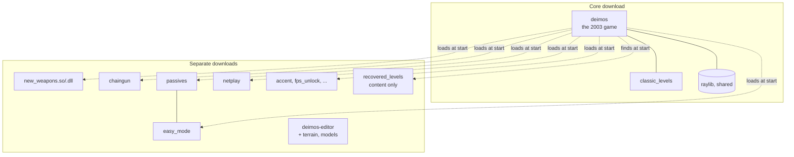
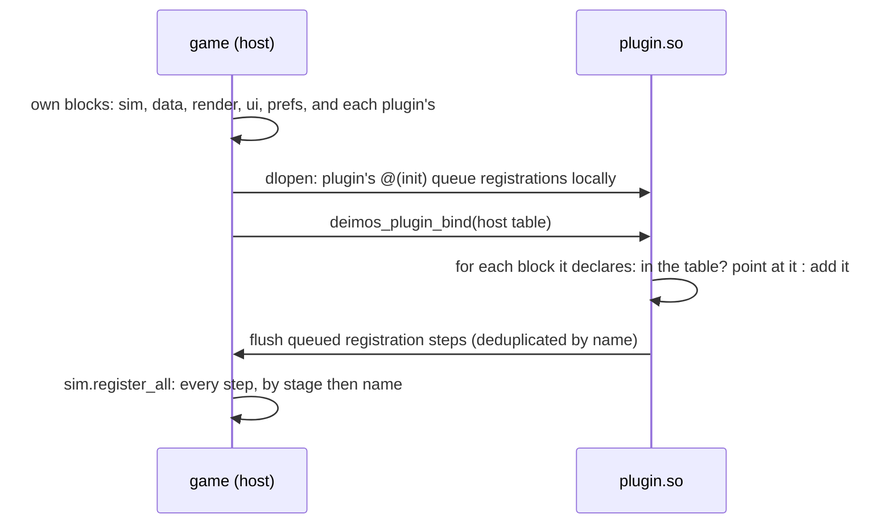
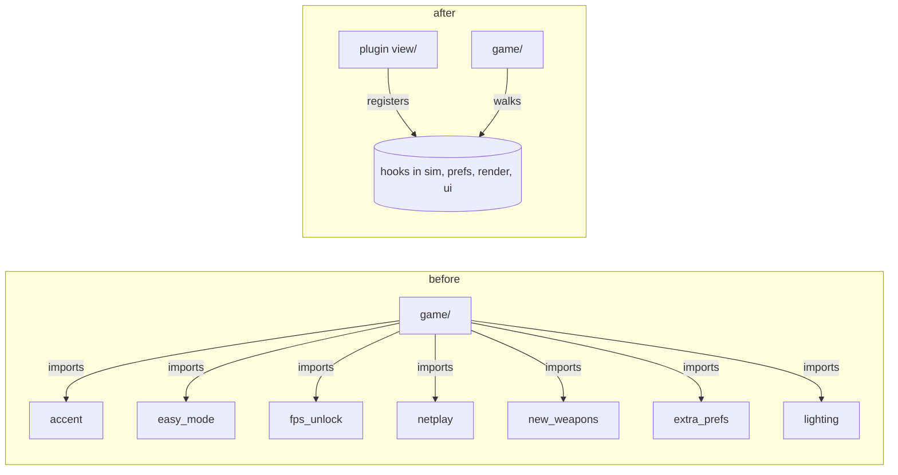
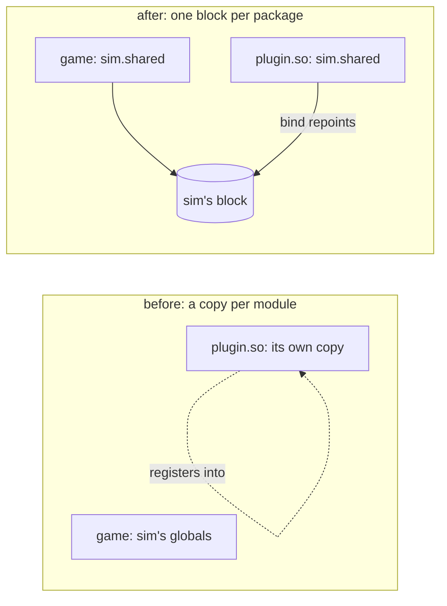
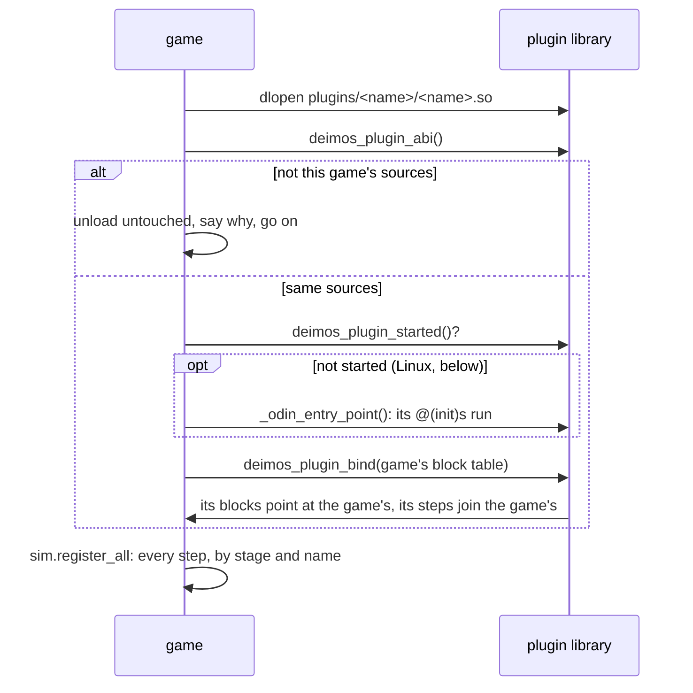
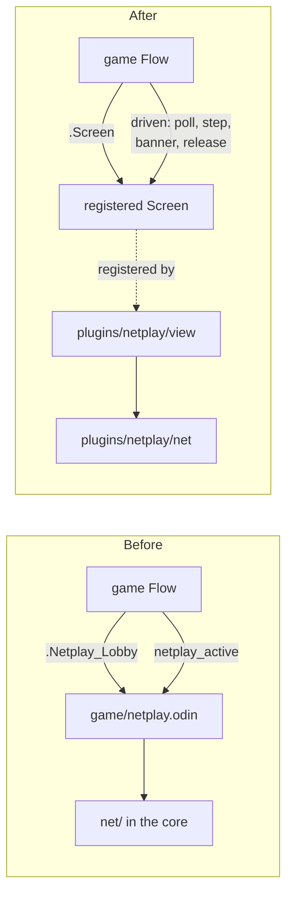
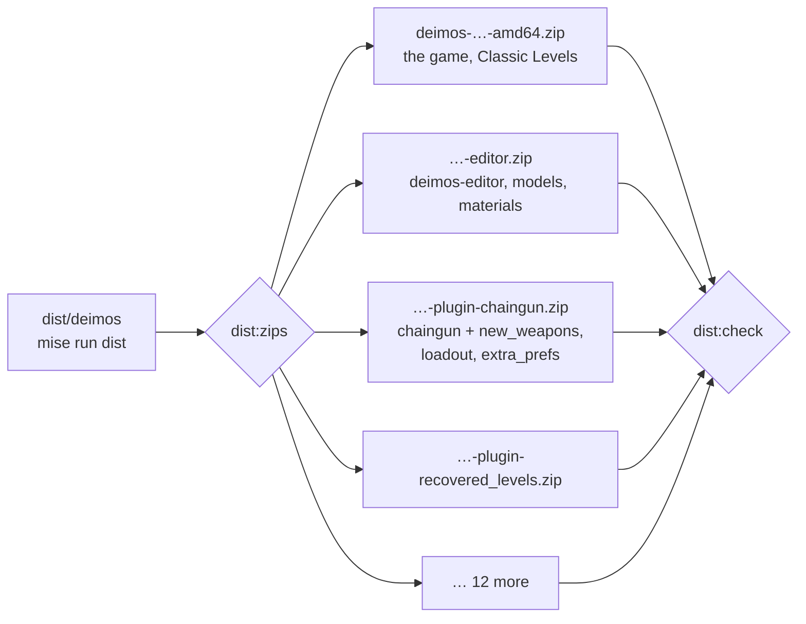

# Phase 10 — The plugin split

**Status: complete.** Stages 0–5 were built on stacked branches and
merged into `main` through `ecs-refactor` (#8): the workflow and
website, the core naming no plugin, one copy of the state, plugins loaded from libraries, netplay out of the core,
and a release that is the game alone plus one download per plugin.

## Why

Every addition since Phase 5 rode in the one binary and the one zip. By
2026-10-06 the release carried the game, netplay, two new weapons, nine
passives, easy mode, a loadout screen, accent colours, a level editor, its
terrain toolchain and model library, and a second set of twelve levels.

| Release | Zip (Linux) |
|---|---|
| v0.1.239-ecs-refactor, 2026-10-02 | 167.8 MB |
| v0.1.276-ecs-refactor, 2026-10-06 | 252.8 MB |

What the zip holds today (sizes on disk, `du -sh`, 2026-10-08):

| Part | Size | Who needs it |
|---|---|---|
| `assets/` audio, data, sprites, images, films | ~85 MB | the game |
| `assets/models`, `materials`, `bases` | ~17 MB | the editor, to be confirmed in stage 5 |
| `plugins/classic_levels` | 55 MB | the game |
| `plugins/recovered_levels` | 34 MB | players who want them |
| `deimos-editor` | one binary | level makers |

And the code is not split either. The plugins are compiled into the game
(`game/plugins.odin` imports all sixteen packages), and `game/` names six
of them directly: `accent`, `easy_mode`, `fps_unlock`, `netplay`,
`new_weapons` and `extra_prefs` (29 call sites, counted 2026-10-08). So
the core cannot build without them, which breaks the rule in AGENTS.md
that the core names no plugin.

## Where it ends



- The core zip runs the original game, and nothing else, with no plugin
  present. Classic mode needs no plugin at all.
- A code plugin is a shared library (`plugins/<name>/<name>.so` or
  `.dll`) beside its content. The game loads every one it finds at
  startup, before `sim.register_all`. (Planned "in dependency order";
  stage 3 found the order does not matter, below.)
- A content plugin (levels, campaigns) is a folder with a `plugin.json`,
  as data plugins already are (D52).
- The level editor is a download of its own.

## The hard part: one copy of the state

An Odin shared library that imports `dr:sim` compiles its own copy of
`sim`, globals included. A plugin's `@(init)` would register its systems
into its own copy, and the game would never see them.

The fix keeps every package's code as it is and moves its mutable
package-level state behind one pointer, which the loader points at the
game's state:



### Verified by a spike (2026-10-08, Odin dev-2026-07, Linux)

A host and a `-build-mode:shared` library sharing one package, in the
scratchpad, before any of this was planned:

- **Binding works.** After the plugin pointed its copy of `core.g` at the
  host's block, both sides read and wrote the same dynamic array and map:
  a map entry the host wrote was found by the plugin's lookup, and the
  reverse.
- **typeids agree.** `typeid_of(core.Thing)` was equal in host and
  plugin: they are hashes of the type, not table indexes. odecs keys
  components by typeid, so this was the deciding question.
- **Floating point agrees.** A 1,000-term float sum was bit-identical in
  both, as expected from the same compiler and flags.
- **`@(init)` runs at `dlopen`**, before the host can bind anything, so
  registrations must queue in the module and be flushed on bind.
- **Registrations after binding were lost** in the spike's first cut
  (they went to the plugin's local queue). Once bound, registration must
  write straight to the shared block.
- **Hazard:** `type_info_of` on a typeid only the plugin defines returned
  a non-nil but empty record in the host. The host must never format or
  reflect on a plugin's own types (`fmt` with `%v`, for one).

Not yet verified: the same on Windows (DLL `@(init)` from `DllMain`, the
process heap shared between modules), and raylib built shared
(`-define:RAYLIB_SHARED=true`, `libraylib.so.600` and `raylib.dll`, both
present in Odin's vendor tree) drawing from a plugin. Stage 3 starts with
both.

### What has to move

Package-level variables, counted 2026-10-08 (excluding tests): about 100
declarations across `sim` (29), `odecs` (12), `data` (10), `render` (4),
`prefs` (4), `ui` (2), `sim/systems/collision_system` (3), and the plugins
(about 50). (Stage 2 counted them with a parser instead of grep: 126,
of which 35 were already `@(rodata)`, and odecs needed no block. See
"Stage 2" below.) Two kinds:

- **Literal tables** (`SIN_BITS`, `GLYPH`, `LEVEL_ORDER`, `DEPS`): the
  same in every module, so a copy is harmless. They become `@(rodata)`.
- **State** (registries, pools, plugin IDs set at registration such as
  `new_weapons.ID`, the view packages' effect lists): moves into the
  package's shared block.

A check (`mise run purity`, extended) then fails any package-level
variable that is neither `@(rodata)` nor in a block, so the rule cannot
erode.

## Stages

Each stage is a feature branch and a pull request, stacked on the one
before, each with its site entry.

| # | Branch | What | Done when |
|---|---|---|---|
| 0 | `site-and-workflow` | The website, its generator and Pages deployment; the pull request workflow and `site:check`; AGENTS.md for branches and pull requests; this plan | PR open, site builds, check passes |
| 1 | `core-names-no-plugin` | Extension points for what `game/` asks of plugins: frame pacing, ship accents, level-select toggles, lobby toggles, netplay pause. `game/` imports no plugin; `mise run purity` enforces it | `game/plugins.odin` is the only file that names a plugin; oracle and fingerprints unchanged |
| 2 | `shared-state` | `dr:blocks`: blocks, bind and merge; every package's state moved into its block, tables to `@(rodata)`; the check | neutral: oracle, fingerprints, DPS report unchanged |
| 3 | `runtime-plugins` | Plugins built as shared libraries, raylib shared, the loader, an ABI stamp the loader checks, Windows verified in CI; `game/plugins.odin` gone | the core zip plays classic with `plugins/` empty, and with every plugin loaded plays as before |
| 4 | `netplay-plugin` | The lobby, session and `net/` out of `game/` into the netplay plugin, behind a session-driver extension point | the netplay loopback checks pass with the plugin, and the core has no netplay |
| 5 | `separate-downloads` | Release split: core zip, one zip per plugin, the editor zip, Recovered Levels zip; the site's download page lists them | each zip installs by unzipping into the game folder |

## Stage 1 — the core names no plugin

`game/` named six plugins at 29 call sites, and seven after the rebase
onto the newer `ecs-refactor` (lighting's sliders shot). Now it names none:
`game/plugins.odin`, the list of what is in the build, is the one file in
`game sim data render ui prefs net oracle` that imports a plugin, and
`mise run purity` fails any other.



Each question the game asked a plugin by name became a hook the plugin
answers (decisions.md D82):

| The game asked | Now | Registered by |
|---|---|---|
| `netplay_plugin.paused` | `sim.paused`: a `Hold` with `pause = true` | netplay |
| is netplay's plugin on? | `Plugin.online`, `sim.mods_online` | netplay |
| `-highrefreshrate`, then the monitor's rate | `prefs.launch_switch_register`, `render.frame_rate_register` | fps_unlock's view |
| the Easy Mode and New Weapons buttons | `ui.setup_switch_register`, per screen | easy_mode's and new_weapons' views |
| `accent.HUE_P1`, `HUE_P2`, `SELF_OUTLINE` | `Setting.player`, `prefs.player_hue_setting`; the renderer gets the effective settings | accent's view |
| the Extras preview ships | `ui.settings_preview_register` | accent's view |
| is Extra Preferences on? | `prefs.settings_page_register` | extra_prefs' view |
| `level_select_easy`, `preferences_extras`, `preferences_extras_sliders` shots | `ui.menu_shot_register`: a plugin, a core screen, a setup | easy_mode's, accent's and lighting's views |

Two behaviours the code carried for a plugin moved out with it:

- The netplay level-end check turned Easy Mode on in code when
  `DR_NETPLAY_END` was set. It now passes `-mod easy_mode`, which turns any
  plugin on for a run by name.
- The Start packet's flags (Easy Mode and New Weapons as bits, from before
  mods were sent in Start on 2026-09-26) are sent as 0 and ignored. Every
  build since 2026-09-27 compares a build hash in Hello, so no peer still
  reads them; the field stays so the packet's layout does not change.

### Verified (2026-10-08, Odin dev-2026-09, CI's)

- `mise run ci` green: 283 tests in `tests/` (six new, in
  `extension_points_test.odin`, pin each plugin's registrations; two
  removed, for the flags' old decoding), and every plugin's own.
- `mise run oracle:diff:saved`: all 25 films match to the end.
- Menu shots, 36 scenarios, before and after: 30 byte-identical,
  `level_select_easy`, `preferences_extras` and every lobby screen among
  them. The other six (`chaingun`, `chaingun_charge`, `chaingun_release`,
  `discharge`, `discharge_charge`, `discharge_windup`) differ between two
  runs of the old build too, by the same pixel counts in the same places:
  their particles take random directions.
- `netplay:level-end` passes. With `-mod easy_mode` the host holds at
  level 1 on Easy Mode's upgrade screen (host.png looked at; mods {2, 3,
  6, 8, 9, 10}). Without the flag the check *also* passes, held at level 2
  on New Weapons' loadout (mods {2, 6, 9}), since any hold counts: the
  check does not prove which hold it saw.

### Rebased onto `ecs-refactor` @ 6634c3d (2026-10-18)

Upstream's 38 new commits added Realtime Lighting, Water, Wind, Hitstop
and HD Textures. Two of their changes met this stage's:

- **One settings field on the renderer.** Upstream's post passes added
  `Renderer.setting`, every saved setting copied in each frame; this
  stage had added `Renderer.settings`, the settings of the plugins on.
  They are now one field under upstream's name, with this stage's
  meaning, cleared each frame. Upstream's plugins only read it while
  they draw, which is only while they are on, so they see the same
  values.
- **Lighting's menu shot** (`game/main.odin` turned lighting on by
  import) is registered by lighting's view, and
  `menu_shots_name_their_plugin` checks it.

Verified against the rebased `site-and-workflow`, with the new
`mise run ref` and `menu-shots:all`:

- `mise run ci` green: 290 tests in `tests/` (285 on the base).
- `oracle:diff:saved`: all 25 films match to the end.
- `menu-shots:all`: 49 scenarios on the base, 50 here (`extras`, the
  plain Extras page, is new). 35 byte-identical, the sliders shot among
  them. 11 differ between two runs of the base itself; `chaingun` gave
  three different images in five runs of the base; `main` and
  `main_netplay` differ only in the version string (looked at).
- `netplay:level-end` passes with `-mod easy_mode`.

### Still open

- `prefs/prefs.odin`'s `LEGACY_MODS` maps the keys of old preference files
  (`easy_mode=1`) to plugin names. It names plugins by string, not by
  import, and only for files written before mods were saved by name.
  A plugin could register its own legacy key; not worth it until stage 5
  removes a plugin from the build.
- `render.Accent.on` and `Draw_Accent` draw the trims, crosshair and shots
  in the player's hue inside the core renderer. They name no plugin, but
  exist for one. A per-object draw hook would move them; stage 3 is the
  time, when the accent plugin is built apart.
- The level-end check cannot tell Easy Mode's hold from the loadout's
  (above). It should name the hold it expects.

## Stage 2 — one copy of the state

Every package a plugin can import keeps its mutable state in one block,
which binding points at the game's. Nothing loads a plugin yet (stage
3), so this stage is proved neutral, and the binding by tests.



A package's state is a `Shared` struct, a zeroed `shared_block`, and a
`shared` pointer to it, which every read goes through. An `@(init)`
declares the pointer to `dr:blocks` with the package's import path and
`Shared`'s typeid (decisions.md D83):

```odin
Shared :: struct { systems: Registry(System, MAX_SYSTEMS), ... }
@(private) shared_block: Shared
@(private) shared := &shared_block
@(init, private) declare_shared :: proc "contextless" () {
	blocks.declare({name = "sim", ptr = (^rawptr)(&shared), type = Shared, merge = merge_shared})
}
```

`blocks.bind(host)`, called in a plugin with the game's table, checks
every type first and binds nothing on a mismatch. It then repoints each
of the plugin's blocks at the game's, and adds the blocks of packages the
game lacks (another plugin's) to the game's table, so the next plugin
that imports them shares the first one's copy. sim's `merge` carries the
registration steps a plugin's `@(init)`s queued before binding into the
game's, and drops those the game has by name: sim's own, which every
copy queues.

| | Before | After |
|---|---|---|
| package variables in importable packages (parser count) | 196 | 126 |
| of them `@(rodata)` | 53 | 69 |
| mutable, outside a block | 142, in 29 packages | 0 |
| blocks (`shared_block` and `shared`) | 0 | 28 |
| `@(static)` locals | 1 | 1, allowed (below) |

Counted by `tools/globals` after the rebase onto `ecs-refactor` @ 6634c3d,
whose lighting, water, wind and hitstop plugins brought 51 more globals
and 9 more blocks; the first cut, before it, had 91 in 20 packages and
19 blocks.

### What the binary turned out to need

- **A static is a global too.** `sim.component_slot` cached each
  component type's id in a `@(static)`; a plugin's copy would start every
  type at -1 and never register. It now finds an unset id in the shared
  catalog (`catalog_find`), so each module's cache fills from the one
  block. The globals check walks procedure bodies for this reason, and
  allows only this one.
- **A block must start zeroed.** sim's first cut started
  `plugins.count` at 1 (CORE's slot), and the initialiser moved the whole
  135 KB block from `.bss` into the executable's `.data`. The slot is now
  filled by the first `plugin_register`, `registered_plugins` always
  includes it, and the check fails a block with an initialiser.
- **Plugin ids are state.** `easy_mode.ID`, `new_weapons.BEAM` and the
  like are set at registration, so they moved into each plugin's block
  with an accessor (`easy_mode.id()`, `new_weapons.beam()`), and other
  packages call the accessor.
- **odecs needs no block.** Its only package state is its encoded query
  terms (and `_empty_cached_query`, a sentinel), which `mise run purity`
  already keeps every caller out of (D47). A world's components live in
  the world, which is in the session's state, keyed by typeid, which the
  spike showed agrees between modules.
- **Plugins import each other** (accent, fps_unlock, loadout, passives
  and new_weapons import extra_prefs; chaingun imports new_weapons; and
  more), so plugin packages have blocks too, and the check covers them,
  view packages included.

### The check

`tools/globals` parses packages with `core:odin/parser`. With `-check`,
run by `mise run purity` over `sim` and its subpackages, `data`, `prefs`,
`render`, `ui` and every plugin package but its tests, it fails:

- a mutable package-level variable that is neither `@(rodata)` nor the
  package's `shared_block` or `shared`;
- a `@(static)` local, except `component_slot`'s;
- a `shared_block` with an initialiser.

A stray global and a stray static planted in `plugins/chaingun` each
failed it, with their file and line.

### Verified (2026-10-18, Odin dev-2026-09, CI's, after the rebase)

- `mise run ci` green: 296 tests in `tests/` (six new in
  `blocks_test.odin`: rebinding and merging, a type mismatch, joining,
  a full table, the declared blocks, sim's merge), and every plugin's own.
- `mise run oracle:diff:saved`: all 25 films match call for call.
- `tests/golden/fingerprints.txt` unchanged.
- `mise run dps:report` against stage 1's build (`mise run ref
  REF=core-names-no-plugin TASK=dps:report`): the HTML is byte-identical.
- Menu shots, all 50 scenarios (`menu-shots:all`, `menu-shots:diff`):
  stage 1's build rendered twice differs from itself in 12 (particles);
  stage 2 differs from it in those 12 and in `main` and `main_netplay`,
  where the crop of the difference is the version string, v0.1.281 against
  v0.1.282, one commit more.
- `mise run bench`, both builds run alternately, two runs each (µs):

  | | stage 1 | stage 2 |
  |---|---|---|
  | demos, per step | 11.34, 11.82 | 11.69, 11.60 |
  | sessions, per step | 15.89, 15.93 | 15.78, 15.74 |
  | snapshot, level 6 | 3.39, 3.37 | 3.47, 3.40 |
  | snapshot, fullest | 7.34, 7.36 | 7.35, 7.38 |
  | restore, fullest | 6.64, 6.88 | 6.92, 6.89 |
  | checksum, fullest | 50.49, 48.69 | 50.65, 50.42 |

  Unchanged within noise. The first cut measured the fullest world's
  snapshot 5% slower; after the rebase it is not.
- Size, the `build` task's game binary, Linux: 17,640,728 → 18,011,640
  bytes (+371 KB). By section: Odin's type info `.odinti` +158 KB and
  `.rela.dyn` +134 KB, which the `Shared` typeids pull in for the
  mismatch check; `.text` +71 KB; `.data` −8 KB, `.bss` +12.5 KB.

Not verified: binding across a real shared library. The tests bind
tables in one module; the spike above bound across modules, but before
this code existed. Stage 3 loads the first real plugin.

### Still open

- The `Shared` typeids add about 290 KB of type info to the game. A
  size and a hash of each block's fields, from the ABI stamp stage 3
  needs anyway, would check the same without it.
- `component_slot`'s lookup is a linear search, once per type per
  module, over at most `MAX_COMPONENTS` (128); harmless, not measured apart.
- `net/` and `oracle/` are not checked: no plugin imports them yet.
  Stage 4 moves `net/` under the netplay plugin, and the check's list
  should grow with it.

## Stage 3 — plugins load from libraries

The game imports no plugin. `build:plugins` builds each code plugin, its
package and its `view/`, as `plugins/<name>/<name>.so` (`.dll`), and the
game loads every one it finds in a plugins folder before
`sim.register_all`. `game/plugins.odin` is gone, and purity fails any
core file that names a plugin, with no exemption.



- **One raylib.** The game links raylib shared (`RAYLIB_SHARED`) and
  finds it beside itself: RUNPATH `$ORIGIN` on Linux, the application's
  folder on Windows. The game and every library draw through it: one
  window, one GL context, one set of textures.
- **The order does not matter.** Blocks bind by package name, and
  registration steps run sorted by stage and name (D50), so a library
  registers what it would have compiled in whatever order the folders
  are read. The plan's "dependency order" was not needed.
- **An ABI stamp.** `tools/plugins/abi.sh` digests every Odin source a
  library can carry a copy of (the core's packages, the plugins', and
  `third_party/`), with carriage returns dropped; the game and each
  library are built with it (`DR_ABI`). The loader checks it before the
  library's runtime starts and refuses a stale one by name. Netplay
  needs nothing more: every library a game loads was built from its
  sources, and peers already compare a build hash.
- **A library is not content.** `content_digest` skips `.so`, `.dll`
  and the linker's by-products, so a Linux and a Windows peer agree.
- **`all_plugins`** imports every plugin, for the tests, the tools that
  measure plugins' content (`clips`) and `build:static`, the game with
  every plugin compiled in, the reference the libraries are checked
  against and a single binary to debug.

### What Odin turned out to do

A library's `@(init)`s never ran on Linux. Odin dev-2026-09 passes the
linker `-Wl,-init,'_odin_entry_point'` for a shared library, and runs
clang without a shell, so the quotes reach `ld` and name no symbol; `ld`
leaves the library without a `DT_INIT`. Seen two ways: `readelf -d` on a
plugin lists no `INIT`, and a clang wrapper that logged its arguments
shows the quotes. A Windows DLL's `DllMain` does start its runtime. So
the loader asks (`deimos_plugin_started`: has sim declared its block?)
and calls the exported `_odin_entry_point` itself when it has not. Once
Odin is fixed the call is skipped by the same question.

A first cut started a stale library's runtime and then unloaded it, and
the game crashed. The ABI is now checked first, and a library whose
runtime has started is never unloaded.

### Numbers (2026-10-18, Linux, Odin dev-2026-09)

| | compiled in (`build:static`) | libraries |
|---|---|---|
| game binary | 18.0 MB | 1.9 MB, and raylib 2.1 MB beside it |
| plugin libraries | — | 14, 29 MB: hitstop 15.2 MB (its clips), the rest 0.5–1.4 MB |
| build | one link | game ~14 s, the 14 libraries ~22 s in parallel |
| start to `-list-plugins` | 445 ms | 444 ms (mean of 5) |
| registration hash | 6e230e9bb732befc | 6e230e9bb732befc |

The release folder with only Classic Levels in `plugins/` is 167 MB, and
starts, plays and opens Preferences.

### Verified

- `mise run plugins:check`, in CI on Linux and Windows: the libraries
  register the same 17 plugins, ids, versions and registration hash as
  the static build (`diff` of `-list-plugins`); the game alone, with only
  Classic Levels beside it, registers nothing else and starts; a library
  built with another ABI, and a library that is not a plugin (raylib,
  renamed), are each refused by name and reason, and the game goes on.
- `mise run ci` green: every test suite, now through `all_plugins`.
- `mise run menu-shots:all`, the base (static) twice against the
  libraries: 38 scenarios byte-identical in all three, and the same 14
  that differ between two runs of the base (presentation particles)
  differ against the libraries.
- `mise run netplay:level-end` passes with the libraries.
- Not run here: `netplay:loopback` and `netplay:reconnect` need Xvfb,
  which this machine lacks (they fail without a display on the base too).

### Still open

- Odin's `-init` quoting: report it upstream; the loader's start call
  stays harmless once it is fixed.
- A plugin's dependencies on another plugin are by registration, not by
  library: `chaingun.so` carries its own copy of `new_weapons`' code and
  binds to the game's block for it. Each library is self-contained, at
  ~1 MB each; a library per plugin with shared dependencies would need
  libraries that link each other.
- macOS (`.dylib`) is written but not built or run.

## Stage 4 — netplay is a plugin

The lobby, its sessions and the network code are the netplay plugin's.
`net/` is `plugins/netplay/net/`, and `game/netplay.odin` (1,395 lines)
is `plugins/netplay/view/netplay.odin`. The game reaches them through
one new extension point, a **screen** (`game/screens.odin`, D86): an
item on the main menu that opens a plugin's own screen, and that screen
may then *drive* the session it starts, stepping it in place of this
machine's input.



What the game keeps, and asks the screen through `Screen`:

| The game | The screen (netplay's) |
|---|---|
| the main menu item, shown while its plugin is on | `label`, `open`, `update`, `draw` |
| startup | `launch`: `DR_NETPLAY=host` or `join:<address>` |
| the pause menu over a shared pause, and its line | `pause_note` |
| holding still while it is held: Escape leaves, F5 plays on alone | `banner`: the peer is lost |
| each render frame, each step | `poll`, `step`, then `flow_after_step` for the effects and sounds |
| the end of the session, its high scores under the lobby's names | `release`: close the socket, say goodbye if the player left |
| the diagnostics overlay | `stats`: ping and rollbacks |
| menu shots, and the shot a test saves | `shot` (a `menu_shot` procedure), `framed` |

- **`game` has a block.** The view imports `dr:game` to use its Flow,
  setup switches and campaign helpers, so `game` is now among the
  packages whose state must live in a block (D83). Its tables are
  `@(rodata)`, and its four pieces of state (the screens, the campaign
  list, the Mods page's order, the last frame's axes) are in its
  `Shared`. `mise run purity` checks `game/` too.
- **The core has no netplay code.** `purity`'s core list no longer has
  `net`, which is now a plugin package. `net/` is exempt from the sim's
  purity rule, as a view is: sockets and wall-clock time are its job.
- **menu-shots finds a screen's shots.** `tools/refs/menu_shots.sh` reads
  the cases of a view's `menu_shot` procedure, as it reads
  `run_menu_shot`'s.

### Numbers (2026-10-18, Linux, Odin dev-2026-09)

| | stage 3 | stage 4 |
|---|---|---|
| `game/` source | 6,258 lines | 4,939 lines (+136 for screens and its block) |
| game binary | 1,939,336 B | 1,883,496 B |
| `netplay.so` | 826,088 B | 1,634,512 B (it now carries a copy of `game`) |
| registration hash | 6e230e9bb732befc | 6e230e9bb732befc |

### Verified

- `mise run ci` green, and `mise run purity` with `game/` in the
  globals check.
- `mise run plugins:check`: the same 17 plugins, ids and hash from the
  libraries as compiled in; the game alone starts.
- `mise run menu-shots:all` on stage 3 twice and on this branch: 52
  scenarios each. The same 38 are byte-identical across all three,
  among them all nine lobby shots, `diagnostics` and `main_netplay`
  (the main menu with its NETPLAY item). The same 14 differ between two
  runs of stage 3 (presentation particles).
- `mise run netplay:level-end` passes: two games, one hosting and one
  joining through `DR_NETPLAY`, play to the level's end through the
  plugin's screen, hold play there, and run five seconds more.
- Not run here: `netplay:loopback` and `netplay:reconnect`, which need
  Xvfb, as in stage 3.

### Still open

- Two netplay names remain in the core.
  - `prefs.Prefs.netplay_name` is saved in `prefs`, because settings
    hold only numbers. A string setting would let the plugin own it.
  - Preferences' controls page says player 1's controls are "also yours
    in netplay", whether or not the plugin is there.
- The netplay tests (`net_test`, `desync_test`, `rollback_session_test`,
  the `Link` fixture and the tests that use it) are still in `tests/`.
  AGENTS.md says a plugin owns its tests; they move with the `Link`
  fixture to `plugins/netplay/tests/`.
- `netplay.so` doubled in size by carrying `game`. Moving what the lobby
  needs from `game` (the setup switches, the campaign list) into `ui`
  would shrink it again.

## Stage 5 — one download per plugin

A release is now the game alone, the level editor, and one zip per
plugin, instead of one zip of everything (`tools/dist/zips.sh`,
`mise run dist:zips`; D87). Every zip holds a `deimos/` folder, so each
unzips over the same game folder, in any order.



- **A plugin's zip brings what it needs.** A library carries its
  dependencies' code (D85), so `chaingun.so` alone registers New
  Weapons, and plays the ordinary gun without the weapons in
  `plugins/new_weapons/`. The zip follows the dependencies the game
  itself reports (`-list-plugins`, run in the release folder) and takes
  each one's folder. Zips overlap where plugins share one; the files
  are the same build's, so unzipping both changes nothing.
- **Missing content is reported.** `-list-plugins` marks a plugin whose
  library registered it but whose folder is missing `content missing`,
  and exits 1, so a half-installed plugin is found by a check rather
  than by playing (it was found that way, before the zips bundled their
  dependencies). A data-only plugin is registered by its folder, so it
  is never missing. The first version flagged any plugin without its
  content, and CI failed on both systems: its checkout has HD Textures
  as a manifest alone. Every local run had passed, on a machine with the
  textures made. Checked since in a clean worktree (`mise run ref`).
- **The editor's assets are the editor's.** `assets/models`,
  `materials` and `bases` are read only through `dr:terrain` and the
  editor; the game imports neither. They go in the editor's zip, which
  takes 13 MB off the game's.
- **A manifest alone has no zip.** HD Textures' folder in a release is
  its `plugin.json`; the textures are made locally (`hd:textures`).
- **`dist:check` installs each one** as a player would, with no window,
  on both systems in CI: the game's zip alone registers Classic Levels
  and nothing else; each plugin's zip over it loads, finds its content,
  and registers exactly the plugins it brings; and all the zips together
  are the release folder, file for file.
- **The build could return early.** `plugin_libs.sh` could exit with
  its last library still being linked (`wait -n` returned for the
  process substitution its list came from), so `plugins:check` failed
  one run in three, and a release could have been zipped a library
  short. It now reads the list whole first; four runs of four pass.
- **The site links them.** The home page's buttons are the game's zip,
  and each plugin's card links its own (`site/build.mjs` reads them
  from the release; `SITE_RELEASES=<file>` reads a saved answer instead).

### Numbers (2026-10-18, Linux, Odin dev-2026-09)

Zipped with `zip -9`, without HD Textures' local textures, as CI has
none.

| Download | Size |
|---|---|
| everything, as one zip (stage 4's release) | 257.7 MB |
| **the game** | **119.3 MB** |
| Recovered Levels | 94.1 MB |
| Hitstop | 26.2 MB |
| the level editor | 13.6 MB |
| New Weapon Passives (with New Weapons, Passives, Loadout, Extra Prefs) | 1.8 MB |
| Chaingun (with New Weapons, Loadout, Extra Prefs) | 1.5 MB |
| each of the other ten | 0.1–1.0 MB |

The game a player needs to start is 46% of what it was.

### Verified

- In a clean worktree of the branch, as CI checks it out (`mise run
  ref`): `build:linux`, `build:static`, `plugins:check`, `dist`,
  `dist:zips` and `dist:check` pass, with 15 plugin zips; HD Textures,
  a manifest there, has none. On this machine, which has the textures
  made, it is 16, HD Textures' own 400 MB zip among them.
- `dist:check` once stopped without a word in a clean checkout: `diff`
  exits 1 when the folders differ, as they do by a skipped manifest, and
  `pipefail` made that the script's exit. Locally the folders were
  identical, so it had passed.
- From the game's zip alone, unzipped, `DR_MENU_SHOT=main` renders the
  main menu without a NETPLAY item, and `DR_SHOT ... -level le03` plays
  Lucena to step 120; both images looked at.
- A chaingun-only install, before the zips bundled their dependencies:
  `-list-plugins` printed `plugin 4 new_weapons ... content missing` and
  exited 1.
- The site, built against a release made from these zips
  (`SITE_RELEASES`): the game's buttons, the editor's links, and a
  download line on every plugin card but Classic Levels' ("comes with
  the game").
- Not run here: the Windows side, which uses 7-Zip; CI runs both
  tasks there.
- Not checked: the editor started from its zip over the game's. It
  opens a window, and `dist:check` has none.

### Still open

- No zip holds everything. A player who wants every plugin unzips
  fifteen; an "everything" zip would put back the 258 MB download
  beside the others.
- Hitstop's 26 MB is its sounds; a compressed format would shrink it.
- The editor is checked only by `dist:check`'s file-for-file step, not
  started.

## Decisions to record as they are made

- Plugins are built from the same commit as the game they load into, and
  the loader refuses any other (an ABI stamp: a hash of the core's
  sources). Mixing releases is out of scope.
- Netplay peers already compare a registration hash (`registration_hash`,
  D50); a loaded plugin's stamp joins it, so peers with different plugin
  builds refuse each other instead of desyncing.
